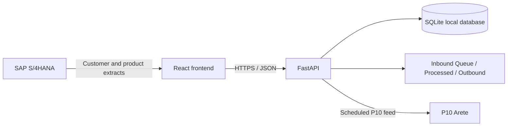

# ArBa Promo Volume Predictor

ArBa is a React web application backed by FastAPI for weekly baseline planning,
promotions, administration, and SAP/P10 integration configuration. Volumes are
entered in cases (CS). The application is served as a React production build;
the legacy embedded page is not used as the frontend.

## Run the application on Windows

### Production-style local run

1. Install Node.js 20 or later and the FastAPI app dependencies from the
   repository root:

   ```powershell
   python -m pip install -r requirements.txt
   ```

2. From the repository root, build the React app:

   ```powershell
   Set-Location frontend
   npm install
   npm run build
   ```

3. From the repository root, start the FastAPI server:

   ```powershell
   python "ArBa Volume Planner.py"
   ```

4. Open <http://127.0.0.1:8171>. The FastAPI server serves the built React app
   and its assets. API documentation is available at
   <http://127.0.0.1:8171/docs>.

The local backend uses SQLite by default. Set `ARBA_DB_PATH` to select a
database file, `ARBA_FILES_DIR` to choose the inbound/outbound file root, and
`ARBA_SECRET` to configure the session signing secret. Microsoft Entra sign-in
is optional and remains disabled until the `ARBA_ENTRA_*` settings are supplied.

### Frontend development

Run the FastAPI server on port `8171`, then use a second PowerShell terminal:

```powershell
Set-Location frontend
npm install
npm run dev
```

Open <http://localhost:5173>. Vite proxies `/api` and `/health` to the local
FastAPI server. Changes to React and CSS are hot-reloaded.

## Configuration screens

Administrators can use Configuration to:

- The first non-seeded account registered with a password or through SSO
  automatically becomes the global ArBa administrator. Later self-registered
  accounts start as VIEWER and need access assigned by an administrator.
- Create user IDs and update roles, sales organization access, plan-account
  assignments, organization-admin access, and active status. The first
  non-seeded user assigned to a Sales Org is automatically its ArBa
  administrator. An ArBa administrator can grant other users admin access in
  the same or another Sales Org; each administrator's planning access is
  limited to their assigned administrator organizations.
- Upload customer and product master extracts as CSV or XLSX, stage them in
  Inbound Queue, validate and consume them, and track processed files.
- Set daily, weekly, monthly, or quarterly pipeline schedules using an IANA
  timezone, local run time, date range, and calendar date selectors.
- Review and download inbound and outbound files.

System administrators retain global Configuration access. Sales-Org
administrators can use Access Management and planning screens for their
administrator Sales Orgs; platform-wide pipeline, master-file, and audit
configuration remains restricted to system administrators.

Promotion statuses are presented as Entry, Planned, Approval Pending, and
Approved. Saving an Entry moves it to Planned; confirming a Planned promotion
sends it for approval. Only an APPROVER can approve Approval Pending
promotions. A future Approved promotion can be reverted to Planned for edits.
Promotion product rows show the baseline calculated across the selected
shipment ISO weeks, and users enter total cases.

Weekly Volume remains the baseline planning grid. It supports extracting the
listed plan account's future P09-by-ISO-week baseline to XLSX and uploading that
workbook after editing. The workbook columns are `Customer ID`, `Product P09`,
`Week`, and `Baseline Cases`; upload validates the account, listed products,
future horizon, and duplicate week/product rows before saving any values.
Promotion entry adds listed products from a dropdown and shows only the chosen
products with their baseline, editable total cases, and calculated uplift.
Promo Calendar groups promotions by sub-brand and displays the tactic across
shipment ISO weeks, with Planned, Approval Pending, and Approved status colors.

Active users who have not logged in for 30 days are deactivated by the
application scheduler. FileConnector pipeline locations are relative to the
configured ArBa files root and must be placed directly in `Inbound Queue` or
`Outbound`; files must be CSV or XLSX. Generic inbound pipelines validate and
archive master files but report PARTIAL until a target-specific mapping is
configured.

## Architecture



`frontend` contains the Vite + React + TypeScript application. The FastAPI API
and local persistence are provided by the repository-root
`ArBa Volume Planner.py` entrypoint. FastAPI serves the compiled assets from
`frontend/dist` after `npm run build`; API requests remain under
`/api/v1`.

## Extract formats

Customer master CSV/XLSX headers should include a market code or sales
organization, plan-account L04 code, and plan-account name. Product master
headers should include P09 code, product description, brand, and P10 material
number. Sub-brand, category, material description, and split share are
optional. One product may occupy multiple rows when it has multiple P10
materials.

## Assumptions and limitations

See [docs/assumptions.md](./docs/assumptions.md). Local authentication is
available for development; production SSO requires Entra configuration. A
production deployment should use a durable database, HTTPS, managed secrets,
and a separate process or worker for scheduled pipeline execution.
